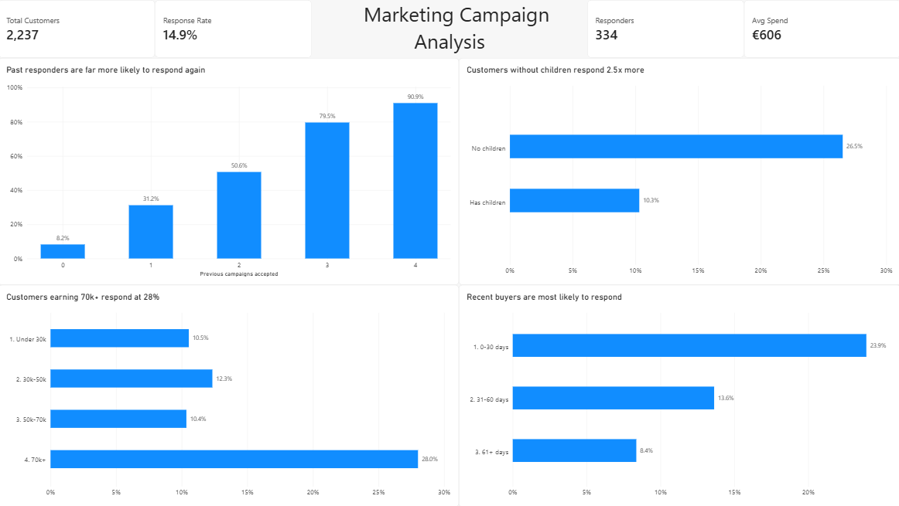

# Marketing Campaign Performance Analysis

**Tools:** SQL (SQLite), Power BI

**Author:** Merdi Mayindu

## Business problem

A food retailer has run six marketing campaigns, and the latest one performed far better than the rest. This project uses SQL to work out **which customers respond to campaigns, what drives that response, and where future marketing budget should go**.

## Dataset

iFood marketing campaign data, raw version (`marketing_data.csv`), originally shared by Jack Daoud on [Kaggle](https://www.kaggle.com/datasets/jackdaoud/marketing-data): 2,240 customers, 28 columns covering demographics, spending by product category, purchase channels and the response to each of six campaigns.

## Data checks and cleaning

- Confirmed 2,240 rows with 2,240 unique customer IDs, so there are no duplicates.
- **Income was stored as text** (e.g. `$84,835.00 `). Removed the symbols and converted it to a number. 24 customers with no income were kept but left out of income-based analysis.
- Removed **3 impossible birth years** (1893, 1899, 1900), leaving 2,237 customers.
- Grouped 7 **invalid marital status values** ("YOLO", "Absurd", "Alone") into a cleaner Couple / Single field.
- Created a clean view (`marketing_clean`) with new fields: age, number of children, total spend, total purchases and number of previous campaigns accepted.

## Key findings

| Area | Finding |
|---|---|
| Campaigns | The latest campaign got a **14.9%** response, double the best previous campaign (7.5%). Campaign 2 was worst at 1.3% |
| Past behaviour | Response rises from **8.2%** (no previous campaigns accepted) to **79.5%** (3 accepted) |
| Income | Customers earning 70k+ respond at **28.0%**, more than double every other band |
| Household | No children **26.5%** vs with children 10.3%. Customers without children also spend almost 3x more |
| Recency | Bought in the last 30 days **23.9%** vs 60+ days 8.4% |
| Value | Responders spend **83% more** on average than non-responders (987 vs 539) |
| Products | Wine (50.2%) and meat (27.6%) make up over three-quarters of revenue |
| Channels | Store 46.2% of purchases, web 32.6%, catalog 21.2% |

### Best target segment

Customers who **accepted a previous campaign and have no children** respond at **50.0%**, over 3x the average. They are about 10% of customers but produced **34% of all responses**.

## Recommendations

1. **Target past responders first.** Customers who accepted an earlier campaign are 3–10x more likely to respond.
2. **Focus budget on high-value customers:** high income, no children, single.
3. **Time campaigns around recent purchases,** and run a separate win-back offer for customers inactive for 60+ days.
4. **Lead with wine and meat offers,** and keep in-store promotion strong.
5. **Don't repeat Campaign 2's approach,** which reached only 1.3%.

## Dashboard

## Files

| File | Description |
|---|---|
| `marketing_analysis.sql` | All SQL queries, with the business question and finding for each |
| `marketing_dashboard.pbix` | Power BI dashboard |
| `dashboard.png` | Dashboard screenshot |
